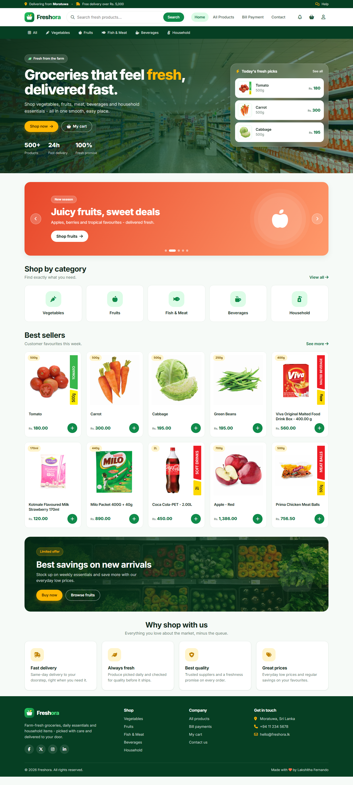
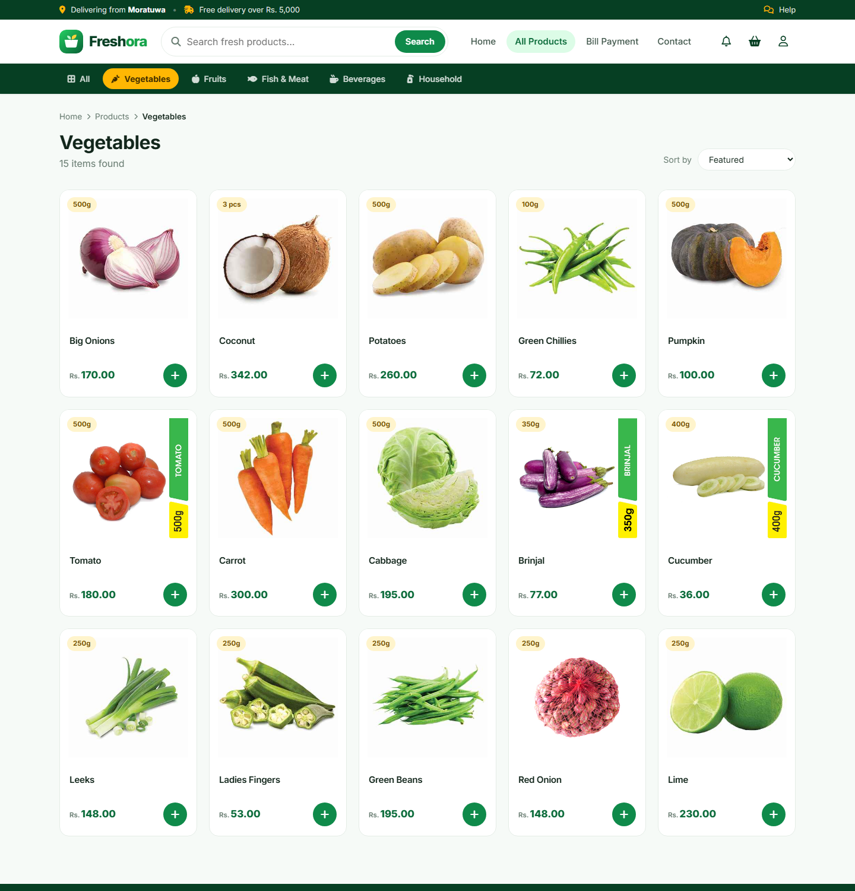
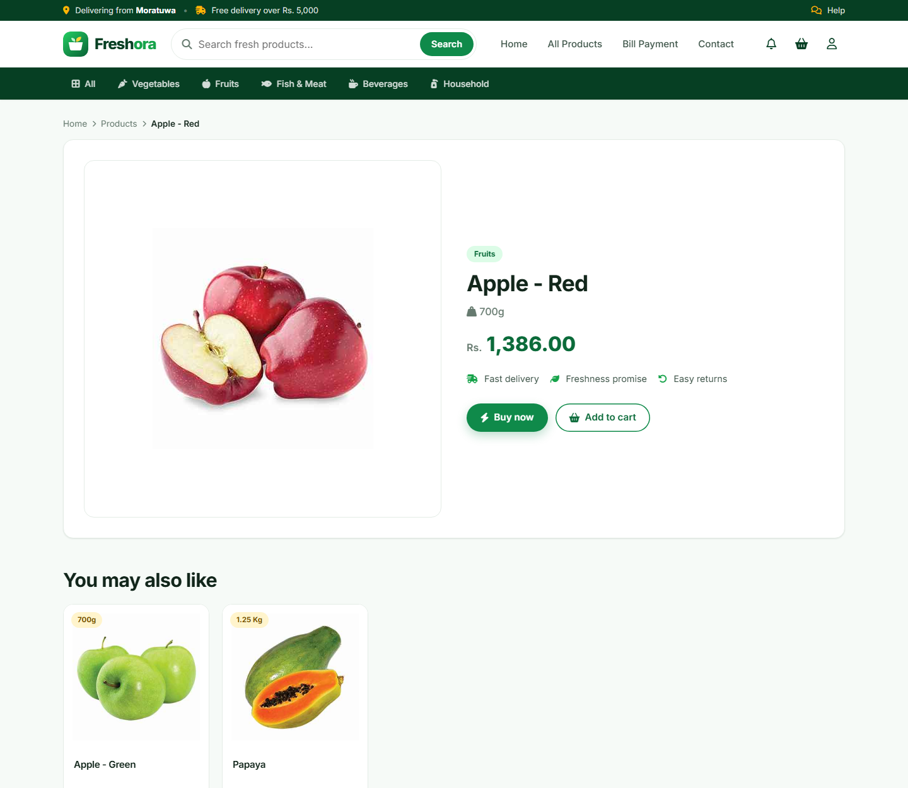
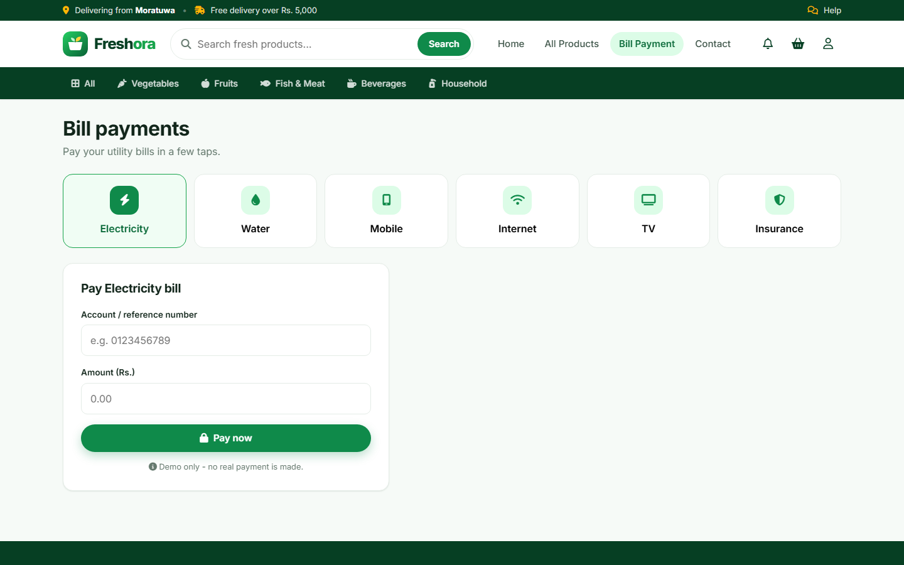
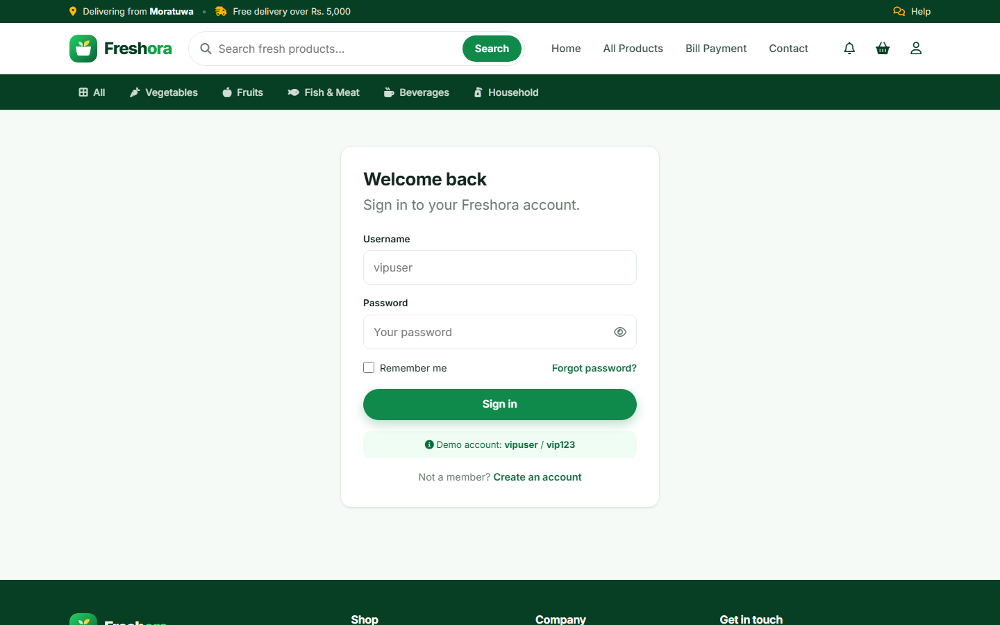

# Freshora - Supermarket E-Commerce Website

Freshora is a modern, responsive online supermarket front end built with **Angular 17** and **Bootstrap 5**. Shoppers can browse fresh groceries by category, search and sort products, manage a cart with coupons, and pay utility bills - all in one smooth, mobile-friendly interface.

Live site: https://freshora-store-aab49.web.app/ (deployed with Firebase Hosting)

## Screenshots

**Home** - hero, offers carousel, categories, best sellers and promotions



**Products** - category page with sorting and search



**Product details** - price, pack size, add to cart and related items



**Bill payments** - pay electricity, water, mobile and other bills



**Sign in** - account access with a demo login



## Features

- Responsive, modern design (desktop, tablet and phone) with a custom Freshora logo
- Home page with a hero section, auto-playing offers carousel (pause on hover, arrows, dots, swipe), category tiles and best sellers
- Product catalogue across five categories: Vegetables, Fruits, Fish & Meat, Beverages and Household
- Search, category filters and sorting (price and name)
- Product details with related products
- Shopping cart saved in the browser: quantity controls, free-delivery progress, coupon codes (`FRESH10`, `WELCOME5`) and a demo checkout
- Bill payments, contact form, sign in / sign up, profile and notifications pages
- Toast notifications for cart and account actions
- Server-side rendering and prerendering with Angular SSR

## Pages

| Route | Page |
| --- | --- |
| `/` | Home |
| `/all-products` and `/all-products/:category` | Products |
| `/product-details/:name/:id` | Product details |
| `/myShopping-cart` | Cart and checkout |
| `/bill-payment` | Bill payments |
| `/contact` | Contact us |
| `/sign-in` and `/sign-up` | Account |
| `/profile` | Profile (requires sign in) |
| `/notifications` | Notifications |

## Tech stack

- Angular 17 (modules, router, SSR / prerendering)
- Bootstrap 5.3 and Font Awesome 6
- RxJS, TypeScript
- Firebase Hosting

## Getting started

Requirements: Node.js 18 or newer and npm.

```bash
npm install
npm start          # dev server at http://localhost:4200
npm run build      # production build in dist/super-market
npm test           # unit tests (Karma + Jasmine)
```

## Project structure

```
src/
  app/
    Components/    pages and UI (header, footer, home, products, cart, ...)
    Services/      cart, products, auth and notification services
    Models/        data models
  assets/          logo and images
docs/screenshots/  README screenshots
```

## Demo notes

This is a front-end project with no backend yet:

- The product list is stored in `Product.service.ts`.
- Sign in uses a demo account (`vipuser` / `vip123`); sign up, contact, bill payment and checkout only simulate success.
- The cart is saved in the browser's `localStorage`.

## Credits

- Hero and promotion photos from [Unsplash](https://unsplash.com).
- Product images are linked from their original online sources.
- Built with [Angular CLI](https://github.com/angular/angular-cli) 17.3.6.

Made by Lakshitha Fernando.
